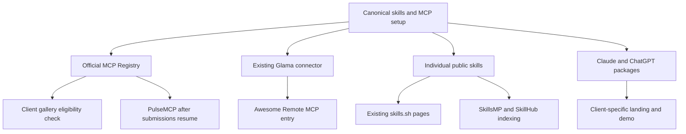

# Referral acquisition plan

Prepare distribution around specific jobs: orchestrate delivery work, run a headless workflow, review a change, explain a pull request, install a useful skill, or understand code relationships. Each referral should land on the corresponding example or setup path. A generic AI-tools listing pointing at the homepage is a weaker hypothesis.

The [canonical register](store.json) contains 48 sources. There are **26 preparation opportunities, three maintenance tasks, eight pending-source checks, ten holds and one rejection**. Several preparation opportunities first require eligibility checks. None is an acceptance or traffic forecast. A technically compatible client is not automatically an approved partner.

## What the demand evidence supports

The [GSC baseline](../2026-10-21-days1-5/2026-10-21-query-opportunities.md) has early exposure for SDLC orchestration and software-factory language. `sdlc orchestrator` had five impressions at average position about 8; `ai software factory` had four around position 14. These are useful direction signals with very small samples. The single `software factory ai` click at a very low reported position is too sparse to extrapolate.

Broad `ai code review` had seven impressions around position 61. Lead with an actual workflow and measured example rather than a generic best-tool claim. Code-graph queries also have small samples; they justify practical traceability content, not a large paid allocation.

The [earlier Planner study](../2026-10-22-keyword-planner-and-skills.md) shows broader informational demand for context engineering, agent harnesses and AGENTS.md. That makes useful skills and research editorial material plausible. Automotive suggestions dominated some harness expansion, so broad volume does not establish relevant developer demand. Client-specific and commercial SDLC volume/CPC remain uncollected.

## Start with these concrete packages

| Package | Deliverable to prepare | Destination | Sources it can support |
| --- | --- | --- | --- |
| Chat-client engineering workflow | One issue-to-reviewed-change demo; Claude.ai and ChatGPT setup sections; truthful client-specific copy | `/plugins` and `/docs/plugin-setup` | Claude, ChatGPT, remote MCP catalogs and editor clients |
| A useful local skill | One runnable explain-change or code-review example; actual input/output; public source and install steps | Canonical public skills repo and the individual skill | skills.sh, SkillsMP, SkillHub, curated lists, Console, developer publishers |
| Headless delivery task | One successful terminal/CI journey with bounded input, result and limitations | `/agent` and public CLI source | npm metadata, DevHunt, JavaScript Weekly, launch directories |
| Durable software-factory step | Tested workflow showing approval, retry/recovery and resulting evidence | `/features/workflow-as-code` and `/ai-sdlc` | DBOS, n8n, InfoQ, DZone |
| Code understanding | A small code-to-test traceability or PR-explanation example, with a readable diagram where useful | `/features/knowledge-graph` or the relevant article | DEV, Hashnode, DZone and permitted community discussions |

These are reusable evidence packages, not five new feature projects. Pick current working behavior. Do not block useful distribution on optional model tests, new analytics or unrelated product changes.

## Source-by-source actions

The tables use short recommendations; the JSON holds eligibility, audience, capability, cluster, destination, evidence, due date, owner, effort estimate and offers for every row. P0 means first preparation work, P1 means next batch, and P2 means lower expected relevance or greater uncertainty. These are ordinal research priorities, not calculated ROI.

| # | MCP and skill discovery | Decision and next useful action |
| --- | --- | --- |
| 1 | [Official MCP Registry](https://modelcontextprotocol.io/registry/remote-servers) | P0: reconcile the existing `io.github.vasparshin/aictrl` namespace and corrected draft; verify public state and preserve ownership. Supports downstream client discovery. |
| 2 | [Glama](https://glama.ai/mcp/connectors/dev.aictrl/aictrl) | P0 maintain: existing owned connector is live; improve factual use-case/setup metadata. Observed site links are nofollow. |
| 3 | [PulseMCP](https://www.pulsemcp.com/submit) | Hold: submissions and edits are paused. Prepare the upstream registry record and recheck the notice. |
| 4 | [MCPservers.org](https://mcpservers.org/submit) | Monitor the existing free application after its review window; do not pay simply to accelerate it. |
| 5 | [MCP.so](https://mcp.so/submit?type=remote-server) | Prepare remote metadata, then inspect comparable engineering listings and paid-link terms before evaluating its fee. |
| 6 | [MCPMarket](https://mcpmarket.com/submit) | Monitor the existing code-review skill. Evaluate the paid Try Now link against the free listing rather than creating another submission. |
| 7 | [Smithery](https://smithery.ai/) | Hold the integration decision: verify a direct catalog route around the announced proxy/managed-identity shutdown. |
| 8 | [LobeHub](https://lobehub.com/mcp) | Inspect the current publisher UI and remote OAuth eligibility; official publishing document was inaccessible. |
| 9 | [skills.sh](https://skills.sh/aictrl-dev/skills) | P0 maintain: task groups are already live. Investigate four absent skill entries and improve useful examples; avoid artificial installs. |
| 10 | [SkillsMP](https://skillsmp.com/about) | Check indexing of the canonical public skills; prepare a correction only for an actual gap. API subscriptions are not listing fees. |
| 11 | [SkillHub](https://www.skillhub.club/) | Check existing entries, publishing requirements and a suitable category for one specific skill. |

| # | Client and package ecosystems | Decision and next useful action |
| --- | --- | --- |
| 12 | [Claude marketplace](https://claude.com/marketplace/connectors-plugins) | P0: reconcile the existing plugin acknowledgement; inspect connector and plugin routes separately; prepare the working-client demo. |
| 13 | [ChatGPT plugin directory](https://developers.openai.com/plugins/deploy/submission) | P0: inspect the existing package/draft; prepare review evidence and missing public setup guidance. Working support does not prove directory approval. |
| 14 | [Cline](https://github.com/cline/mcp-marketplace) | Check remote-only/public-repo eligibility and test installation before preparing the prescribed issue template. |
| 15 | [Continue](https://docs.continue.dev/customize/mcp-tools) | Hold publication: MCP configuration is documented, but the Hub route returned 502. Verify availability before building a block. |
| 16 | [Cursor Directory](https://cursor.directory/) | Inspect its current community-plugin route and manifest requirements; do not imply first-party endorsement. |
| 17 | [Devin Desktop / Windsurf](https://docs.devin.ai/desktop/cascade/mcp) | Hold catalog plans: current documentation redirects to Devin Desktop; an open submission route is unverified. |
| 18 | [OpenCode](https://github.com/anomalyco/opencode/pull/37248#issuecomment-6347664637) | Monitor the already-posted reconsideration comment. A current skills install plus remote configuration supersedes old adapter-only instructions. |
| 19 | [VS Code / GitHub MCP gallery](https://code.visualstudio.com/docs/agent-customization/mcp-servers) | Verify upstream ingestion and reuse the registry record; count syndication as a related surface. |
| 20 | [GitHub Marketplace](https://docs.github.com/en/apps/github-marketplace) | P0: reconcile publisher verification/application state; prepare accurate app screenshots and a real review result. |
| 21 | [npm through the official CLI](https://github.com/aictrl-dev/cli) | Resolve the existing package identity from source; prepare useful keywords, homepage and README corrections. Do not publish a redundant wrapper. |

| # | Curated resources and integration partners | Decision and next useful action |
| --- | --- | --- |
| 22 | [Awesome Remote MCP Servers](https://github.com/punkpeye/awesome-remote-mcp-servers) | Prepare the remote-specific entry after endpoint and Glama checks. Flag its requested-star condition for genuine human judgment. |
| 23 | [Awesome Claude Code](https://github.com/hesreallyhim/awesome-claude-code) | Human handoff only: selective human-written recommendations through its web issue form; agent prepares factual eligibility evidence. |
| 24 | [Awesome Agent Skills](https://github.com/VoltAgent/awesome-agent-skills) | Prepare one established skill with real usage, author prefix and a description within ten words. Sponsorship is separate. |
| 25 | [n8n creator templates](https://support.n8n.io/article/becoming-an-n8n-template-creator-and-getting-help) | Build and test the workflow before preparing an application. Generic MCP support is not a published integration. |
| 26 | [DBOS](https://www.dbos.dev/) | Prepare an actual durable execution case study. Internal use is a factual basis for a story, not an existing co-marketing agreement. |

| # | Comparisons and launch discovery | Decision and next useful action |
| --- | --- | --- |
| 27 | [AlternativeTo](https://alternativeto.net/faq/) | Check the existing pending suggestion and reviewer questions; do not create another app entry. |
| 28 | [Product Hunt](https://www.producthunt.com/launch) | Audit prior launch history and prepare a meaningful release with a live demo and clear install path. |
| 29 | [DevHunt](https://devhunt.org/) | Check existing status and prepare a runnable CLI/tool launch; keep the paid header separate. |
| 30 | [Peerlist](https://peerlist.io/launchpad) | Verify project/launch history; prepare a useful free local-skill demo for the developer audience. |
| 31 | [Uneed](https://www.uneed.best/pricing) | Free-first metadata preparation; weaker target-audience evidence makes paid date selection a low priority. |
| 32 | [BetaList](https://betalist.com/criteria) | Hold unless the release genuinely meets new/recent-product criteria. Paying is not an eligibility workaround. |
| 33 | [PlugandShip](https://plugandship.dev/p/aictrl-dev-engineering-skills) | Existing free public page; monitor its previously assigned 6 November slot. Current next-free-slot text does not move that date. |
| 34 | [FutureTools](https://futuretools.io/submit-a-tool) | Check the already-permitted resubmission outcome. No further duplicate application. |
| 35 | [There's An AI For That](https://theresanaiforthat.com/submit/) | Hold: primary pricing and eligibility were inaccessible. Do not use aggregator prices as facts. |
| 36 | [NeuronFeed](https://neuronfeed.com/guides/get-listed) | Check the existing free submission; no verified approval or engineering referrals yet. |

| # | Publishers and communities | Decision and next useful action |
| --- | --- | --- |
| 37 | [Console.dev](https://console.dev/selection-criteria) | Await the email already sent from bulat@aictrl.dev. Keep a runnable local trial ready for an editor's question. |
| 38 | [TLDR Dev / DevOps](https://advertise.tldr.tech/audiences/software-developers/) | Paid hold pending a small bounded quote and edition fit; no verified public rate. |
| 39 | [Changelog](https://changelog.com/news/submit) | Prepare original research or an open-source release. Its free news route excludes tutorials and commercial-product pitches. |
| 40 | [InfoQ](https://www.infoq.com/write-for-infoq/) | Prepare a vendor-neutral production lesson with reproducible evidence and affiliation disclosure. |
| 41 | [DZone](https://dzone.com/articles/dzones-article-submission-guidelines) | Prepare an original traceability/automation tutorial with useful code and current editorial-rule review. |
| 42 | [DEV](https://dev.to/guidelines-for-ai-assisted-articles-on-dev/) | Improve existing article/draft quality, canonical and AI disclosure before preparing another article. |
| 43 | [Hashnode](https://docs.hashnode.com/blogs/editor/writing-a-blog-post) | Prepare a practical example with Original URL canonical and an audience-specific introduction. |
| 44 | [Reddit engineering communities](https://www.reddit.com/r/AI_Agents/) | Research permitted participation in r/AI_Agents and r/claudeskills; disclose affiliation. Coordinate r/HeadlessAgents with its CLI owner. |
| 45 | [Hacker News / Show HN](https://news.ycombinator.com/newsguidelines.html) | Human-only writing and participation. Provide a runnable artifact checklist; do not generate or automate posts/comments. |
| 46 | [Web Tools Weekly](https://webtoolsweekly.com/) | Hold until a current official suggestion/advertising route is found. A tested UI skill is the natural audience fit. |
| 47 | [JavaScript Weekly / Cooperpress](https://cooperpress.com/advertise/) | Prepare a relevant Node/TypeScript release note and verify the editorial route. Public aggregate audience figures are stale. |
| 48 | [daily.dev](https://business.daily.dev/pricing/) | Reject the current recurring plan for this bounded test. Revisit only a documented suitable one-off option. |

## Related surfaces form a tree

This is a dependency map. It does not promise automatic ingestion or count the same upstream metadata as several independently earned links. GitHub/npm/VS Code share an operator family; Glama and the remote awesome list are also related. Reddit communities are children of one source record, with separate local rules and ownership.

## Paid shortlist: evaluate the referral path

| Offer observed on 22 October | Price | Demand/audience reason | Decision |
| --- | ---: | --- | --- |
| MCPMarket individual skill | $29 | Coding-skill intent; paid option adds Try Now, absent from free. No source-specific traffic result. | Best small hypothesis to investigate; verify upgrade of existing application and qualified paid-link terms. |
| MCP.so remote server | $39 | Exact protocol/client category fit; search demand for this directory is unmeasured. | Inspect comparable engineering listings and all-in terms first. |
| MCPservers.org premium review | $39 | Same relevant catalog, but free application already pending. | Hold: mostly buys faster review. |
| PlugandShip fast-track | $19 | Open-source fit, but current page and free launch slot already exist. | Hold: limited incremental benefit. |
| Uneed fast-track / date choice | About $15 / $40 | Broader founder audience; engineering demand unproven. | Free-first; hold paid. Exact cents retained in JSON. |
| DevHunt header, one week | $149 | Stronger developer fit; uses about 75% of the ceiling before fees. | Hold: too concentrated without placement-level evidence. |
| Console / TLDR / Cooperpress | Quote | Engineering audience fit varies by edition. | Editorial routes first where suitable; no assumed affordability. |
| TAAFT / Web Tools Weekly | Unknown | Audience and actual placement terms not fully verified. | Hold; no invented price. |
| daily.dev managed plan | Quote, recurring | Developer audience, but a monthly plan and agreed term. | Reject for this bounded placement experiment. |

MCPMarket and MCP.so together advertise about $68 before unknown fees. This is an arithmetic scenario, **not a purchase recommendation or reserved budget**. None of these offers has demonstrated incremental qualified visits for aictrl. Directory size and vendor traffic claims are not placement-level impressions.

Before selecting either small test: establish the actual outbound referral path, ask for engineering-category placement evidence, inspect comparable pages, verify duration/all-in price/no recurring obligation, reconcile existing liabilities and agree an outcome window. If the value proposition depends on purchasing dofollow ranking credit, decline it. [Google's paid-link guidance](https://developers.google.com/search/docs/crawling-indexing/qualify-outbound-links) requires appropriate qualification; vendor domain-rating claims do not establish ROI.

Use a transparent sensitivity calculation rather than a forecast: a $29 placement would cost about $6 per qualified visit at five qualified visits, or about $1 at 25. A $39 placement would cost about $8 or $2. Those visitor counts are hypothetical breakpoints, not expected results. Without an observed qualification rate or acceptable acquisition cost, the model does not establish profitability.

## Execution order

**First preparation batch:** fix the client landing/setup gap; reconcile registry and existing Claude/ChatGPT/GitHub application state; check indexing of canonical public skills. Keep three listing packages in progress at once. Continue to monitor existing queues on their stated review dates, not every day.

**Second batch:** prepare one remote-list entry and one established-skill entry; build one tested n8n or DBOS case study; develop one publisher article from that evidence. Prefer useful artifacts that can support several related surfaces.

**Third batch:** prepare a meaningful CLI or plugin release for developer launch channels; assess one small paid placement only if free-route evidence and actual terms justify it. Hold recurring offers, inactive submission routes and weakly relevant broad catalogs.

At the seven- and 28-day review after each actual go-live, record source visits, qualification evidence, useful product outcomes and spend where observable. Report uncertainty. A small sample can identify a broken link or irrelevant audience; it cannot prove a scalable channel. Retain the result and next decision in the same source ID so the next SEO cycle starts from evidence.
